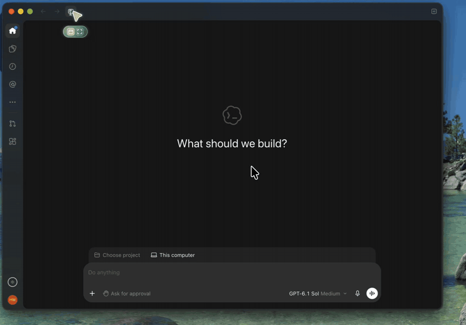

# klms-mcp

**Codex가 KAIST KLMS를 읽게 해 주는 MCP 서버.** 과목, 과제, 퀴즈, 공지, 파일, 마감을 도구로 제공합니다.

[English](README.md)



Chrome 창에서 KAIST SSO 로그인을 한 번 하면, Codex가 실제 KLMS 데이터로 이런 질문에 답합니다.

- "이번 주 마감 알려줘"
- "수리통계학 중간고사 분포 보고 기말 어떻게 공부할지 알려줘"
- "Assignment 4 준비해 줘. 파일 받고 START_HERE.md 써 줘"

KLMS는 읽기만 합니다. 과제 제출처럼 KLMS에 무언가를 쓰는 도구는 없습니다.

## 빠른 시작 (Codex 앱)

1. 빈 폴더를 하나 만듭니다. 예: `~/KLMS`
2. Codex 앱에서 그 폴더를 프로젝트로 엽니다.
3. 새 대화에 아래를 붙여 넣습니다.

> `uvx --from git+https://github.com/hwan809/klms-mcp klms-mcp install` 실행해줘. uv가 없으면 먼저 설치해줘. Chrome에서 내가 KLMS 로그인을 마칠 때까지 기다린 다음 `klms-mcp sweep --dest .`로 지금 바로 KLMS를 이 폴더에 받아줘. klms-mcp는 네트워크가 필요하니 샌드박스 밖에서 실행해줘. `_klms/last_sweep.json`을 보고 마감이 남은 과제마다 `과목/과제명` 폴더에 첨부를 모으고 마감, 제출 형식, 해야 할 일을 정리한 START_HERE.md를 써줘. 그리고 `klms-mcp dashboard --open`을 실행해줘. 마지막으로 이 프로젝트에 평일 아침 9시 자동화를 만들어줘. KLMS MCP의 `klms_sweep`을 `dest_dir`를 이 폴더로 해서 돌리고, 과제 정리를 똑같이 하고, `klms-mcp dashboard`를 실행하고, 새로 생긴 것을 알려줘.

Chrome 창이 뜨면 KAIST SSO 로그인(2단계 인증 포함)을 마칩니다. 첫 점검은 10분 정도 걸리고, 끝나면 브라우저에 대시보드가 뜹니다.

### 결과물

```
~/KLMS
├── Introduction to Deep Learning
│   ├── lectures/          강의 자료와 과목 파일
│   ├── assignments/       과제 첨부파일
│   ├── notices/           공지 전문 (마크다운)
│   └── Assignment 4/
│       ├── 2026F_CS371_assignment4.ipynb
│       └── START_HERE.md  마감, 지각 규정, 제출 형식, TODO 전체
├── dashboard.html         마감, 타임라인, 최근 공지 (브라우저로 열기)
├── Mathematical Statistics
│   └── ...
└── ...
```

평일 아침 9시마다 Codex가 KLMS를 다시 확인하고 새 과제를 정리합니다. 공지와 강의 자료가 프로젝트 안에 있으니, 그 프로젝트에서 바로 물어보면 됩니다.

마감은 KLMS 활동과 공지 본문 둘 다에서 찾습니다. 그래서 "수요일까지 Gradescope에 제출"처럼 KLMS 과제로는 올라오지 않는 일정도 잡힙니다.

## 준비물

- [Codex](https://openai.com/codex/) (앱 또는 CLI). 다른 MCP 클라이언트도 됩니다. 아래 참고.
- 로그인 창용 Google Chrome 또는 Microsoft Edge. 둘 다 없으면 `uvx --from playwright playwright install chromium`으로 브라우저를 받습니다.
- [uv](https://docs.astral.sh/uv/). 위 프롬프트가 없으면 설치합니다.
- macOS에서 확인했습니다.

## 로그인 유지

KLMS는 3시간 동안 요청이 없으면 세션을 끊습니다. 다시 로그인하려면 비밀번호와 2단계 인증이 필요해서 본인만 할 수 있습니다. 노트북이 밤새 잠들면 아침 9시 실행이 보통 로그인을 다시 요청합니다.

방법은 두 가지입니다.

1. **다시 로그인하기.** Codex가 `klms_login`으로 Chrome 창을 띄웁니다. 처음 로그인할 때 Chrome에 비밀번호를 저장해 두면 버튼 한 번이면 됩니다.
2. **GitHub Actions로 세션 살려 두기 (선택).**

```sh
klms-mcp keepalive enable --public
```

내 GitHub 계정에 리포 `klms-keepalive`를 만들고, GitHub Actions가 30분마다 KLMS를 한 번 열어 노트북이 잠들어도 세션이 유지되게 합니다. GitHub CLI가 없으면 Homebrew나 winget으로 설치하고, 브라우저에서 GitHub 로그인 창을 엽니다. 승인 코드는 클립보드에 넣어 둡니다.

동작 방식과 리포가 public인 이유:

- GitHub 예약 실행(cron)은 믿을 수 없습니다. 매시간으로 걸어 둔 실측에서 13시간 동안 1번만 돌았습니다. 그래서 실행마다 KLMS를 연 뒤 다음 실행을 겁니다. 다음 실행은 environment 대기 타이머로 30분 기다렸다가 시작하고, 이 대기는 Actions 사용량으로 치지 않습니다. cron은 체인이 멈췄을 때 다시 시작하는 용도로만 둡니다.
- 대기 타이머는 public 리포에서만 됩니다(private은 GitHub Enterprise 전용). `--public` 없이 실행하면 아무것도 바꾸기 전에 멈추고 이유를 알려 줍니다.
- 쿠키는 Actions Secret으로 들어갑니다. 로그에서는 가려지고 fork나 PR에는 전달되지 않습니다. 남이 볼 수 있는 것은 워크플로 파일, 실행 시각, "KLMS session alive" 한 줄입니다.
- GitHub에 올라가는 것은 `klms.kaist.ac.kr` 세션 쿠키뿐입니다. 비밀번호와 KAIST SSO 쿠키는 올리지 않습니다.
- 그래도 세션이 끊기면 실행이 실패하고 GitHub가 메일을 보냅니다. 다시 로그인하면(`klms-mcp login` 또는 Codex의 `klms_login`) Secret이 바뀌고 체인이 다시 시작됩니다.
- 끄기: `klms-mcp keepalive disable`

## 도구

| 도구 | 하는 일 |
|---|---|
| `klms_sweep` | 한 번에 점검: 새 강의 자료와 과제 첨부 받기, 공지 전문 저장, 마감과 과제 본문, 공지에 적힌 일정, 새 성적 |
| `klms_upcoming_deadlines` | 전체 과목의 다가오는 과제, 퀴즈 마감 |
| `klms_get_courses` | 수강 과목 |
| `klms_get_activities` | 한 과목의 활동 (과제, 퀴즈, 게시판, 파일) |
| `klms_course_contents` | 과목 전체 콘텐츠: 섹션, 모듈, 파일 |
| `klms_assignment_status` | 과제 하나: 마감, 제출 상태, 성적, 첨부 |
| `klms_quiz_status` | 퀴즈 하나: 열리고 닫히는 시각, 응시, 성적 |
| `klms_get_notices` | 공지 게시판. 기본은 새 글만, `include_seen`이면 전부 |
| `klms_get_notifications` | KLMS 알림 |
| `klms_download_assignment` | 과제 첨부파일 받기 |
| `klms_download_course_files` | 과목 자료실 새 파일 받기 |
| `klms_check_session` | 저장된 세션이 살아 있는지 확인 |
| `klms_login` | Chrome으로 KAIST SSO 로그인 |

받기 도구와 `klms_sweep`는 `dest_dir`를 받습니다. 파일은 `<dest_dir>/<과목>/{lectures,assignments,notices}` 아래에 들어갑니다. 프로젝트 폴더를 넘기면 나중에 Codex가 그대로 읽습니다. 처음 돌 때는 기존 공지를 모두 파일로 받아 두지만 "새 공지"로 알리지는 않습니다.

## 개인정보

- 쿠키, 상태, 로그인 브라우저 프로필은 이 컴퓨터의 `~/.klms-mcp/`에만 있습니다(`KLMS_MCP_HOME`으로 위치 변경). 예외는 위의 선택 사항인 keepalive 하나입니다.
- 받은 파일은 지정한 폴더에만 저장됩니다.
- 중간 서버가 없습니다. Codex는 내 노트북의 klms-mcp와, klms-mcp는 KLMS와 직접 통신합니다.

## 다른 MCP 클라이언트

klms-mcp는 stdio로 MCP를 제공합니다. 한 번 설치하고(`uv tool install git+https://github.com/hwan809/klms-mcp`) 클라이언트에 `klms-mcp` 명령을 등록하면 됩니다. Cursor 예시(`~/.cursor/mcp.json`):

```json
{
  "mcpServers": {
    "klms": { "command": "klms-mcp" }
  }
}
```

## 명령어

```sh
klms-mcp install                 # uv tool로 설치하고 ~/.codex/config.toml에 등록 (기존 파일은 백업)
klms-mcp login                   # Chrome으로 KAIST SSO 로그인
klms-mcp status                  # 세션이 살아 있는지 확인
klms-mcp sweep --dest .          # 지금 전체 점검, _klms/last_sweep.json과 dashboard.html 저장
klms-mcp dashboard --open        # 마지막 점검 결과로 dashboard.html을 다시 그리고 열기
klms-mcp keepalive enable --public | disable | status
klms-mcp uninstall               # Codex 설정에서 빼기
```

## 문제 해결

- **Codex에 KLMS 도구가 안 보입니다.** 설치 후 새 대화를 여세요. Codex는 대화를 시작할 때 MCP 서버를 불러옵니다.
- **아침 9시 실행이 로그인을 요청합니다.** 밤사이 세션이 끊긴 것입니다. 다시 로그인하거나 keepalive를 켜세요.
- **"세션 잠금" 오류가 납니다.** `klms_login`을 한 번 실행해 새 세션을 받으세요.

## 제거

```sh
klms-mcp keepalive disable  # 켜 두었다면
klms-mcp uninstall          # Codex 설정에서 빼기
uv tool uninstall klms-mcp  # 프로그램 지우기
rm -rf ~/.klms-mcp          # 쿠키와 상태 지우기
```

## 안내

KAIST와 관계없는 비공식 학생 프로젝트입니다. 내 로그인으로, KLMS에서 이미 볼 수 있는 것만 읽습니다. 계정 사용에 관한 KAIST 규정 안에서 쓰세요.
