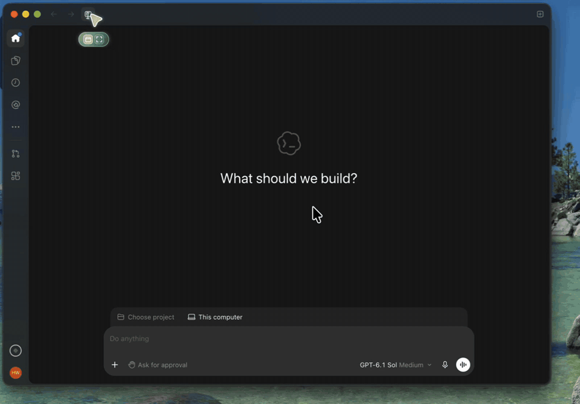

# klms-mcp

**Let Codex read your KAIST KLMS.** Courses, assignments, quizzes, notices, files, and deadlines, as MCP tools.

[한국어](README.ko.md)



You log in once with KAIST SSO in a Chrome window. After that, Codex can answer questions like these from your real KLMS data:

- "What's due this week?"
- "Look at the Mathematical Statistics midterm distribution and tell me how to study for the final."
- "Set up Assignment 4: download its files and write a START_HERE.md."

It only reads KLMS. There is no tool that submits or changes anything.

## Quick start (Codex app)

1. Make an empty folder, for example `~/KLMS`.
2. Open that folder as a project in the Codex app.
3. Paste this into a new chat:

> Run `uvx --from git+https://github.com/hwan809/klms-mcp klms-mcp install` (install uv first if it's missing). Then create a weekday 9 AM automation in this project: run KLMS MCP's `klms_sweep` with `dest_dir` set to this project folder, and for each assignment still due, put its attachments in a `<course>/<assignment>` folder with a START_HERE.md covering the deadline, submission format, and what to do.

A Chrome window opens for KAIST SSO. Finish the login there (including 2FA). The first sweep takes about 10 minutes.

### What you get

```
~/KLMS
├── Introduction to Deep Learning
│   ├── lectures/          lecture slides and course files
│   ├── assignments/       assignment attachments
│   ├── notices/           every notice, saved as Markdown
│   └── Assignment 4/
│       ├── 2026F_CS371_assignment4.ipynb
│       └── START_HERE.md  deadline, late policy, submission format, every TODO
├── Mathematical Statistics
│   └── ...
└── ...
```

Every weekday at 9 AM, Codex checks KLMS again and sets up new assignments. Because the notices and lecture files live in the project, you can ask about them directly in that project.

Deadlines come from both KLMS activities and notice text, so you also see things like "Submit to Gradescope by Wednesday" that never show up as a KLMS assignment.

## Requirements

- [Codex](https://openai.com/codex/) (app or CLI). Other MCP clients work too, see below.
- Google Chrome or Microsoft Edge for the login window. Without either, `uvx --from playwright playwright install chromium` gets a browser.
- [uv](https://docs.astral.sh/uv/). The prompt above installs it if missing.
- Tested on macOS.

## Staying logged in

KLMS ends a session after 3 idle hours. Logging back in needs your password and 2FA, which only you can do. If your laptop sleeps overnight, the 9 AM run will usually ask you to log in again.

Two ways to deal with it:

1. **Just log in again.** Codex opens the Chrome window with `klms_login`. If you let Chrome save your password the first time, it's one click.
2. **Keep the session alive with GitHub Actions (optional).**

```sh
klms-mcp keepalive enable --public
```

This creates a repo `klms-keepalive` in your GitHub account and opens KLMS from GitHub Actions every 30 minutes, so the session survives while your laptop sleeps. If the GitHub CLI is missing, it installs it (Homebrew or winget) and opens the GitHub login in your browser, with the code already on your clipboard.

How it works, and why the repo is public:

- GitHub's scheduled (cron) runs are unreliable. An hourly schedule ran once in 13 hours when we measured it. So each run touches KLMS and then starts the next run, which waits 30 minutes on an environment wait timer. The wait uses no Actions minutes. Cron only restarts the chain if it ever stops.
- Wait timers work only on public repos (private repos need GitHub Enterprise). Without `--public`, the command stops and explains before changing anything.
- The cookie is an Actions secret. It's masked in logs and never given to forks or pull requests. Anyone can see the workflow file, the run times, and the line "KLMS session alive".
- Only the `klms.kaist.ac.kr` session cookies go to GitHub. Never your password or the KAIST SSO cookies.
- If the session dies anyway, the run fails and GitHub emails you. Log in again (`klms-mcp login` or `klms_login` in Codex), and the secret is updated and the chain restarts.
- Turn it off: `klms-mcp keepalive disable`.

## Tools

| Tool | What it does |
|---|---|
| `klms_sweep` | One call for everything: new course files and assignment attachments, all notices saved as files, deadlines with assignment details, dates found in notices, new grades |
| `klms_upcoming_deadlines` | Upcoming assignment and quiz deadlines across all courses |
| `klms_get_courses` | Your current courses |
| `klms_get_activities` | Activities in one course (assignments, quizzes, boards, files) |
| `klms_course_contents` | Full course contents: sections, modules, files |
| `klms_assignment_status` | One assignment: due date, submission status, grade, attachments |
| `klms_quiz_status` | One quiz: open and close times, attempts, grade |
| `klms_get_notices` | Course notice boards. New posts by default, or all with `include_seen` |
| `klms_get_notifications` | KLMS notifications |
| `klms_download_assignment` | Download an assignment's attachments |
| `klms_download_course_files` | Download new course files |
| `klms_check_session` | Is the saved session still alive? |
| `klms_login` | Open Chrome for KAIST SSO login |

Download tools and `klms_sweep` take a `dest_dir`. Files go under `<dest_dir>/<course>/{lectures,assignments,notices}`. Pass your project folder so Codex can read them later. On the first run, existing notices are saved as files but not reported as "new".

## Privacy

- Cookies, state, and the login browser profile stay in `~/.klms-mcp/` on your computer (set `KLMS_MCP_HOME` to move it). The only exception is the optional keepalive above.
- Downloaded files stay where you put them.
- No server in between. Codex talks to klms-mcp on your laptop, and klms-mcp talks to KLMS.

## Other MCP clients

klms-mcp speaks MCP over stdio. Install it once (`uv tool install git+https://github.com/hwan809/klms-mcp`), then point your client at the `klms-mcp` command. For example, Cursor (`~/.cursor/mcp.json`):

```json
{
  "mcpServers": {
    "klms": { "command": "klms-mcp" }
  }
}
```

## Command line

```sh
klms-mcp install                 # install as a uv tool and register in ~/.codex/config.toml (backs up the old file)
klms-mcp login                   # open Chrome for KAIST SSO
klms-mcp status                  # is the session alive?
klms-mcp keepalive enable --public | disable | status
klms-mcp uninstall               # remove it from the Codex config
```

## Troubleshooting

- **Codex doesn't see the KLMS tools.** Start a new chat after installing. Codex loads MCP servers when a chat starts.
- **The 9 AM run says to log in.** The session expired overnight. Log in again, or turn on the keepalive.
- **"Session lock" errors.** Run `klms_login` once to get a fresh session.

## Uninstall

```sh
klms-mcp keepalive disable  # if you turned it on
klms-mcp uninstall          # remove from Codex config
uv tool uninstall klms-mcp  # remove the program
rm -rf ~/.klms-mcp          # remove cookies and state
```

## Disclaimer

An unofficial student project, not affiliated with KAIST. It uses your own login and reads only what you can already see in KLMS. Use it within KAIST's rules for your account.
